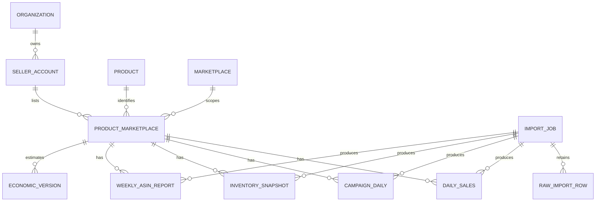

# Decision dashboard and database review

Reviewed 13 October 2026 against live Supabase project `ehanopftvshlbanmhrxu` and production source `430a4452`. Queries are read-only. This change does not modify schemas, permissions or imported business records.

## Evidence and supported decisions

| Source | Observed scope | Suitable use | Decision limit |
| --- | --- | --- | --- |
| sales_daily | 61 dates, 1 product-marketplace, 1 August–30 September 2026; 0 missing revenue/units/sessions | Historical trend, equal calendar period comparison, weighted unit session rate | Not current sales. Latest 7 dates: USD 387.81, 20 units, 160 sessions |
| ad_performance_daily | 0 rows | Identify missing advertising evidence | Spend, ACoS, ROAS and TACoS unavailable. Never assume zero spend |
| inventory_snapshots | 1 snapshot, 22 August 2026; 179 available | Historical snapshot inspection | Not current stock. Suppress stock-cover/reorder decision from stale stock and demand |
| amazon_weekly_workflow_reports | 6 rows, including ASIN and STORE_TOTAL; latest 3–9 October 2026 | Separate weekly review and comparison within one report file | Latest ASIN: USD 419.75, 21 units, 127 sessions. Null sessions on STORE_TOTAL are intentional grain differences |
| price / cost / fee versions | Effective versions with planned status | Explicit current planning economics | Current estimate is not realized profit; overhead, advertising, tax and refunds not included |

No duplicate daily sales keys, duplicate snapshot keys, sales ownership mismatches, sales currency mismatches or missing sales source references were found in the inspected data. This is a point-in-time result, not proof against future bad imports.

## Presentation contract

1. Executive overview: dated recorded revenue/units/traffic, evidence-driven priority queue, trajectories, product comparison and independent weekly business review.
2. Seven domains: Overview, Sales & Traffic, Advertising, Inventory, Finance, Products and Data Quality. Each has a distinct question and does not repeat the whole overview.
3. Product explorer: product-marketplace metrics and drill-down to daily facts, advertising campaign rows, inventory snapshots, weekly periods and effective economic versions.
4. Source inspection: actual scoped records, table/grain, calculation, coverage, import dates and source file where stored; paginated inspection and scoped CSV export. Missing lineage is stated rather than reconstructed.

Marketplace/product/period filters affect daily metrics, charts, product comparisons and CSV rows consistently. Inventory uses the latest snapshot; economics uses today's effective versions; weekly reports keep their own stated periods. These exceptions are labelled in their sections and source detail. The default is latest recorded history; current last 7 completed UTC days exposes missing recent data.

Revenue comparison requires complete adjacent equal-length periods. Mixed currencies are never added without an explicit FX policy. Conversion is calculated from summed units and sessions, not averaged percentages. Missing dates are gaps in charts. Nulls remain unavailable; recorded zeros remain zero. Duplicate daily fact keys invalidate totals. Duplicate advertising campaign/date keys invalidate advertising totals. Source failures are independent and visible.

The two-day freshness guardrail for current sales and inventory is a reversible UI rule. It is not a business SLA, supplier lead time or stock policy. A proper reorder model needs supplier lead time, safety stock, inbound quantities and expected arrival dates.

## Database design findings

| Priority | Finding | Evidence / impact | Proposed repair |
| --- | --- | --- | --- |
| High | Weekly uniqueness omits product and marketplace | UNIQUE(owner_id,source_file,record_type,period_type,period_start,period_end) prevents multiple ASIN rows in the same file/period. No collision observed yet because only one product is present | Separate import identity from fact grain. Link weekly ASIN rows to product_marketplace_id; unique by import + product-marketplace + record/period type + dates. Store totals need a separate grain |
| High | Unknown values are converted to zero in metric views | v_product_daily_performance COALESCEs absent ads to zero; v_product_profitability_daily zero-fills missing costs/fees/ads | Preserve NULL and expose source-presence / complete-input flags. Do not label contribution as realized net profit. The redesigned dashboard reads facts and versions directly, avoiding these substitutions |
| High for multi-tenant use | RLS exists but dimensional policies are broad | product_marketplaces permits any authenticated user to read/update/delete, with INSERT check true. products read policy is also authenticated-wide | Define whether collaboration is company-wide or tenant-scoped before changing access. Introduce organization membership and permissions if multi-tenant. UI owner filters are not database security |
| High | Ownership is repeated without cross-table consistency constraints | Fact owner_id references auth.users; product_marketplace_id references listing independently. No composite constraint binds the two | Backfill/audit first, then composite FK or guarded insert/update derived from listing owner. Zero mismatches currently observed |
| Medium | Advertising nullable campaign permits duplicate aggregates | Unique(product_marketplace_id,campaign_id,performance_date) treats NULL campaign IDs as distinct | Separate product-day aggregates from campaign-day facts or add a partial unique index for null campaign rows after deduplication. UI also refuses duplicate campaign/date rows |
| Medium | Weak import lineage for facts | Daily sales has textual source_ref; inventory has source but no import-job FK; weekly source file is textual | Add nullable import_job_id / ingestion_id FKs, parser version, source hash, imported_at and validation status; backfill only from verifiable matches |
| Medium | Current economics view ignores effective interval and currencies | Latest effective_from wins without excluding future/expired records; costs and fees are COALESCEd and their currencies are not validated | Select effective versions as-of date, require matching currency, distinguish actual/planned/missing. UI now applies those rules using raw version tables |
| Medium | Historical cost version overlaps can be ambiguous | Existing daily profit view takes latest eligible version, masking overlap; no overlap exclusion constraint reviewed | Audit intervals; enforce non-overlap at owner + product-marketplace + version type, with documented boundary convention |
| Medium | Future multi-account grain is incomplete | Listing uniqueness is product_id + marketplace_id; seller_account_id is text on listing | If two seller accounts can list the same product in the same marketplace, introduce a seller_accounts dimension and include account in listing/fact keys |
| Medium | Metric calendar / attribution contract is not encoded | Date columns have no per-marketplace calendar or ad attribution-window metadata | Define source reporting timezone, attribution window and last complete date. Keep imported daily dates unshifted; UTC current-period control is explicit |
| Low / growth | Indexing follows listing/date but not every owner filter | Sales and inventory owner/date indexes exist; ads has listing/date and campaign/date, weekly only PK and import uniqueness | Add owner/date and weekly owner+ASIN+marketplace+period indexes when query plans and volume justify them |

All inspected public base tables have RLS enabled. All inspected public views have security_invoker=true. This does not make broad authenticated policies tenant isolation. No DB policy or constraint was changed in this review.

## Target logical model

Organization/account entities in this diagram are proposed dimensions, not claims that all exist today. Retain the existing listing dimension and source tables; do not build a parallel sales store. Keep reporting views above normalized facts and an append-only raw/import audit below them.

## Safe migration sequence

1. Agree the company/owner/account access model and metric date/attribution contract.
2. Audit and backfill listing ownership, natural keys, duplicates, source lineage and version overlaps with reconciliation totals before/after.
3. Add nullable lineage/account keys and indexes; write through both verified keys during transition.
4. Validate constraints; update parsers and reporting views together. Preserve import history and rollback paths. Reconcile per product/account/market/date and currency.
5. Replace broad policies only after authenticated admin/editor/viewer and cross-company probes pass.
6. Add stable monitoring for fact uniqueness, orphan/owner mismatch, freshness, monetary currency and source completeness.

## Validation

New calculation tests cover date windows, incomplete comparisons, duplicates, weighted ratios, currencies, zero/null distinction, stale stock, effective economics, weekly overlap and CSV formula protection. Existing lineage tests are retained. Required application checks: clean npm install, lint, tests, build, rendered desktop/mobile review, product/market/reset controls, every section, source pagination/export and refresh. Production promotion must be checked against build-info.json.
